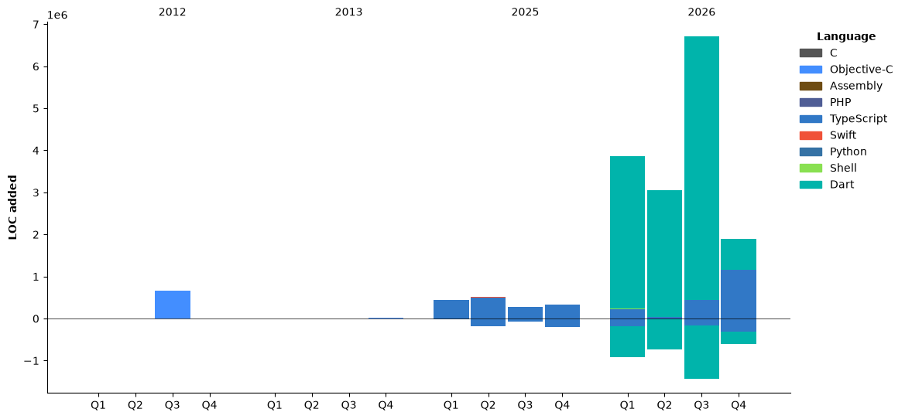

## Hi! I'm pontago 👋

<!--START_SECTION:waka-->


**🐱 My GitHub Data** 

> 📦 1.0 MB Used in GitHub's Storage 
 > 
> 🏆 3,012 Contributions in the Year 2026
 > 
> 💼 Opted to Hire
 > 
> 📜 57 Public Repositories 
 > 
> 🔑 8 Private Repositories 
 > 
**I'm a Night 🦉** 

```text
🌞 Morning                11130 commits       ██████░░░░░░░░░░░░░░░░░░░   23.15 % 
🌆 Daytime                12139 commits       ██████░░░░░░░░░░░░░░░░░░░   25.25 % 
🌃 Evening                12094 commits       ██████░░░░░░░░░░░░░░░░░░░   25.15 % 
🌙 Night                  12721 commits       ███████░░░░░░░░░░░░░░░░░░   26.46 % 
```


📊 **This Week I Spent My Time On** 

```text
🕑︎ Time Zone: Asia/Tokyo

💬 Programming Languages: 
TypeScript               2 hrs               █████████░░░░░░░░░░░░░░░░   34.02 % 
Markdown                 1 hr 10 mins        █████░░░░░░░░░░░░░░░░░░░░   20.07 % 
JSON                     1 hr 5 mins         █████░░░░░░░░░░░░░░░░░░░░   18.61 % 
Other                    41 mins             ███░░░░░░░░░░░░░░░░░░░░░░   11.64 % 
Astro                    29 mins             ██░░░░░░░░░░░░░░░░░░░░░░░   08.46 % 

🔥 Editors: 
Claude Code              4 hrs 14 mins       ██████████████████░░░░░░░   72.03 % 
VS Code                  1 hr 3 mins         ████░░░░░░░░░░░░░░░░░░░░░   17.85 % 
Codex Vscode             29 mins             ██░░░░░░░░░░░░░░░░░░░░░░░   08.40 % 
Neovim                   6 mins              ░░░░░░░░░░░░░░░░░░░░░░░░░   01.72 % 

💻 Operating System: 
Mac                      5 hrs 53 mins       █████████████████████████   100.00 % 
```

🤖 **AI Coding This Week** 

```text
⏱ AI Coding Time: 5 hrs 21 mins (90.95%)

✍️ 5,190 lines written by AI, 0 lines written by hand (100.0% AI-written)

🔤 1,657,172 Input Tokens, 431,142 Output Tokens

💵 $32.04 Estimated AI Cost This Week

🧠 14 AI Sessions, 56 AI Prompts

Opus                     5,277 lines         █████████████████████████   98.99 % 
Claude                   54 lines            ░░░░░░░░░░░░░░░░░░░░░░░░░   01.01 % 
GPT                      0 lines             ░░░░░░░░░░░░░░░░░░░░░░░░░   00.00 % 

🔎 AI Coding Insights:
🤖 AI-Driven — 100.0% of written lines came from AI
📄 Detailed Prompter — average 728 characters per prompt
🔁 Iterative Prompter — average 4 prompts per session
🚀 High AI Trust — 0.0% of changed lines were hand-edited
```

**I Mostly Code in C** 

```text
Dart                     4 repos             ████░░░░░░░░░░░░░░░░░░░░░   15.38 % 
TypeScript               4 repos             ████░░░░░░░░░░░░░░░░░░░░░   15.38 % 
Shell                    2 repos             ██░░░░░░░░░░░░░░░░░░░░░░░   07.69 % 
Python                   1 repo              █░░░░░░░░░░░░░░░░░░░░░░░░   03.85 % 
Swift                    1 repo              █░░░░░░░░░░░░░░░░░░░░░░░░   03.85 % 
```


**Timeline**




 Last Updated on 24/11/2026 04:09:11 UTC
<!--END_SECTION:waka-->
