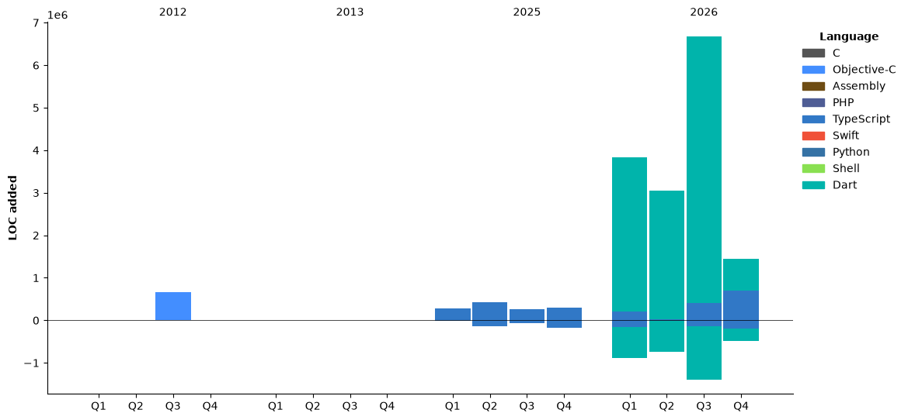

## Hi! I'm pontago 👋

<!--START_SECTION:waka-->


**🐱 My GitHub Data** 

> 📦 1.0 MB Used in GitHub's Storage 
 > 
> 🏆 3,012 Contributions in the Year 2026
 > 
> 💼 Opted to Hire
 > 
> 📜 57 Public Repositories 
 > 
> 🔑 8 Private Repositories 
 > 
**I'm a Night 🦉** 

```text
🌞 Morning                10948 commits       ██████░░░░░░░░░░░░░░░░░░░   23.32 % 
🌆 Daytime                11684 commits       ██████░░░░░░░░░░░░░░░░░░░   24.89 % 
🌃 Evening                11806 commits       ██████░░░░░░░░░░░░░░░░░░░   25.15 % 
🌙 Night                  12499 commits       ███████░░░░░░░░░░░░░░░░░░   26.63 % 
```


📊 **This Week I Spent My Time On** 

```text
🕑︎ Time Zone: Asia/Tokyo

💬 Programming Languages: 
Markdown                 8 hrs 21 mins       ███████░░░░░░░░░░░░░░░░░░   29.17 % 
TypeScript               7 hrs 24 mins       ██████░░░░░░░░░░░░░░░░░░░   25.86 % 
Astro                    2 hrs 28 mins       ██░░░░░░░░░░░░░░░░░░░░░░░   08.63 % 
JSON                     2 hrs 26 mins       ██░░░░░░░░░░░░░░░░░░░░░░░   08.56 % 
Bash                     2 hrs 21 mins       ██░░░░░░░░░░░░░░░░░░░░░░░   08.23 % 

🔥 Editors: 
Claude Code              20 hrs 7 mins       ██████████████████░░░░░░░   70.30 % 
VS Code                  5 hrs 59 mins       █████░░░░░░░░░░░░░░░░░░░░   20.94 % 
Codex Vscode             1 hr 48 mins        ██░░░░░░░░░░░░░░░░░░░░░░░   06.32 % 
Neovim                   41 mins             █░░░░░░░░░░░░░░░░░░░░░░░░   02.43 % 

💻 Operating System: 
Mac                      28 hrs 37 mins      █████████████████████████   100.00 % 
```

🤖 **AI Coding This Week** 

```text
⏱ AI Coding Time: 24 hrs 34 mins (85.83%)

✍️ 13,326 lines written by AI, 5 lines written by hand (99.96% AI-written)

🔤 6,923,070 Input Tokens, 1,719,400 Output Tokens

💵 $179.05 Estimated AI Cost This Week

🧠 26 AI Sessions, 224 AI Prompts

Opus                     11,774 lines        █████████████████████░░░░   84.39 % 
GPT                      1,417 lines         ███░░░░░░░░░░░░░░░░░░░░░░   10.16 % 
Claude                   761 lines           █░░░░░░░░░░░░░░░░░░░░░░░░   05.45 % 

🔎 AI Coding Insights:
🤖 AI-Driven — 99.96% of written lines came from AI
📝 Concise Prompter — average 347 characters per prompt
🔁 Iterative Prompter — average 9 prompts per session
🚀 High AI Trust — 0.16% of changed lines were hand-edited
```

**I Mostly Code in C** 

```text
Dart                     4 repos             ████░░░░░░░░░░░░░░░░░░░░░   15.38 % 
TypeScript               4 repos             ████░░░░░░░░░░░░░░░░░░░░░   15.38 % 
Shell                    2 repos             ██░░░░░░░░░░░░░░░░░░░░░░░   07.69 % 
Python                   1 repo              █░░░░░░░░░░░░░░░░░░░░░░░░   03.85 % 
Swift                    1 repo              █░░░░░░░░░░░░░░░░░░░░░░░░   03.85 % 
```


**Timeline**




 Last Updated on 13/11/2026 23:51:38 UTC
<!--END_SECTION:waka-->
